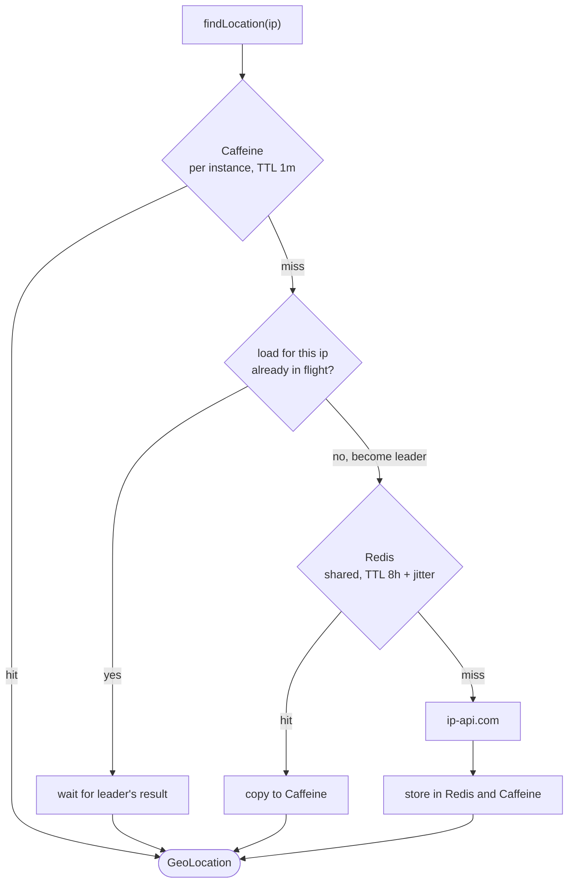
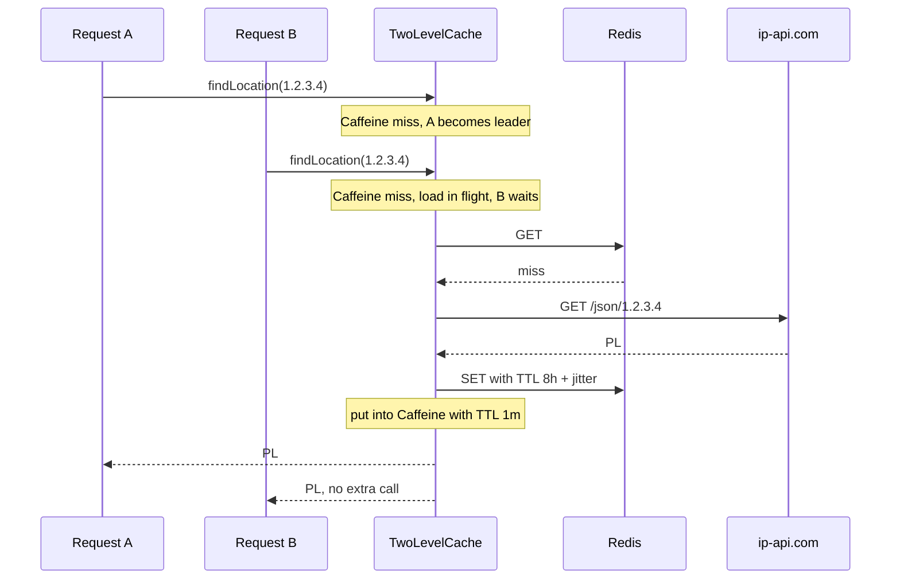

# Sample Coupon Service

[](https://github.com/damianmalczewski/sample-coupon-service/actions/workflows/ci.yml)
[](https://github.com/damianmalczewski/sample-coupon-service/actions/workflows/release.yml)
[](https://github.com/damianmalczewski/sample-coupon-service/releases/latest)
[](https://codecov.io/gh/damianmalczewski/sample-coupon-service)

A throwaway application, used as a sandbox for trying out ideas.

## What it does

- Create coupons with country restriction and usage limit.
- Redeem coupons - enforces country match (resolved from client IP), usage limit, and per-user uniqueness.
- Resolves race of coupon redemptions.
- Geolocation responses cached in Caffeine in front of Redis, with single-flight loads and TTL jitter to avoid
  thundering herd on the external API.
- Flyway-managed PostgreSQL schema.

## Development

Useful Gradle commands:

```bash
# Format and build - runs both test suites, coverage and Spotless
./gradlew

# Run unit tests only
./gradlew test

# Run integration tests only (Testcontainers)
./gradlew integrationTest
```

## Poking at the design

A mix of vertical-slices, screaming and semi-clean architecture.

- _"a mix"_ meaning that it has no strict rules and the architecture was formed in order to explore different styles,
- _"semi"_ meaning JPA annotations are allowed in domain classes, since adding a mapping layer just for this project's
  size felt like busywork.

Most configurable values live in properties, so they can be externalized via env vars or JVM args later if this ever
needs it.

### Coupon Redemption

Redemption uses an atomic `UPDATE` for row reservation:

```kotlin
@Modifying
@Query(
    """
      UPDATE Coupon c
      SET c.usageCount = c.usageCount + 1
      WHERE c.code = :code
        AND c.usageCount < c.usageLimit
      """
)
fun attemptToRedeemInternal(code: String): Int
```

Zero rows affected means coupon exhausted or at limit, so transaction rolled back. Otherwise, concurrent transactions
will wait upon reaching this method until current one concludes.

### Error handling

`ErrorType` interface implemented by `CommonError` and `CouponError` enums. `DomainException` hierarchy (extended by
`CouponException` and others) gives each error its own exception class for clean `catch` and propagation.

DB uniqueness errors are handled by checking which index triggered the exception.

Error responses use [Problem4J](https://problem4j.github.io), an opinionated library that extends Spring Boot's
exception handling with custom RFC Problem Details implementation.

### Geolocation caching

`@Cacheable(sync = true)` backed by `TwoLevelCache` - in-memory Caffeine (short TTL, per instance) in front of Redis
(shared). Concurrent misses for same IP within an instance share one in-flight load, so the herd per key is at most one
external call per instance. Redis TTL gets random jitter, so entries written together (e.g. after cold start) don't
expire together.



Two concurrent requests for the same IP on one instance - only the leader goes past Caffeine:



Local TTL is kept short because local entries are never invalidated across instances - it bounds how long an instance
may serve value that Redis no longer has.

Plain `sync = true` on `RedisCache` gives no such protection - without locking writer each caller loads, with locking
writer all misses of all keys queue on a single cache-wide lock.

### Scalability

Stateless app, cache externalized to Redis - horizontal scaling is straightforward, though it's never had to scale
beyond a laptop.

## Dependencies

- **PostgreSQL** - primary database.
- **Redis** - geolocation response cache.
- **ip-api.com** - translates client IP to country. Can use WireMock on `localhost`.
- **Docker** - needed for local services and Testcontainers.

- [`localhost/`](localhost) - local development setup. Spins up all dependencies, including a pre-configured WireMock
  stub for the IP geolocation service, plus a Hoppscotch collection with predefined requests.
- [`compose/`](compose) - standalone demo deployment of the service together with its dependencies.
