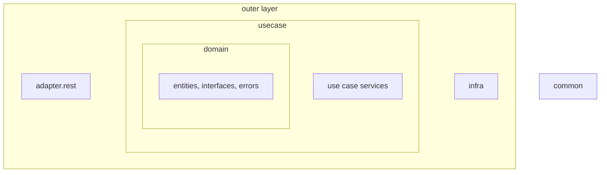
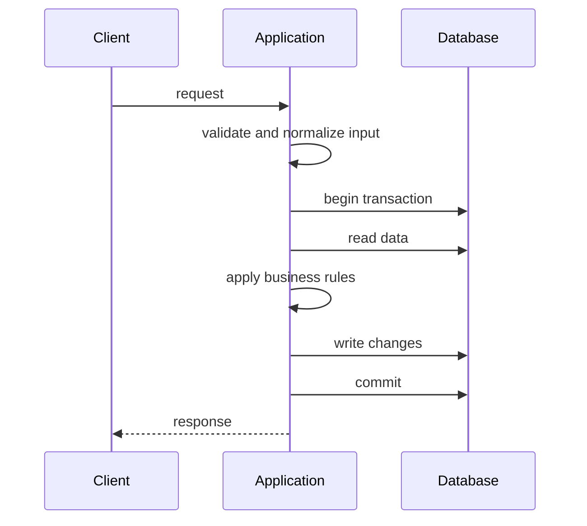

# Architecture

A mix of vertical slices, screaming and semi-clean architecture. The rules are loose on purpose - the project explores
different styles rather than following one strictly. "Semi" because JPA annotations are allowed in domain classes; a
separate persistence model would be busywork at this size.

## Packages

All code lives under `com.example.samplecoupon`:

- **`adapter.rest`** - REST controllers, request and response models, input validation and normalization.
- **`usecase`** - one `@Service` per use case (create, query, fetch, redeem), transaction boundaries, DTOs.
- **`domain`** - entities (`Coupon`, `CouponRedemption`), repository and client interfaces, domain errors.
- **`infra`** - Spring configuration, JPA repositories, geolocation REST client, caching.
- **`common`** - cross-cutting types: error model, paging, string normalization.

The packages form an onion: `domain` in the center, `usecase` around it, and `adapter.rest` and `infra` in the outer
layer. Dependencies point inward - a layer may use the layers inside it, never the ones outside. The outer layer is
stricter still: `infra` uses only `domain`, and `adapter.rest` and `infra` never use each other. `common` stands
apart from the onion: every layer may use it, and it depends on nothing in the application.

The rules are enforced by an ArchUnit test, [`ArchitectureSpec`][architecture-spec] - a dependency in the wrong
direction fails the build.

## Request flow

Each use case runs in its own transaction. Invalid input is rejected before the transaction starts; a broken business
rule rolls the transaction back, so nothing is changed. Either way the client receives a Problem Details error, see
[REST API](./REST-API.md#errors).

## Persistence

PostgreSQL, schema managed by Flyway (`src/main/resources/db/migration/<year>/<month>/`). Hibernate only validates the
schema (`ddl-auto: validate`).

- **`coupons`** - one row per coupon: code, usage limit, usage count, country code, creation time. The code is
  unique (`uk_coupons_coupon_code`).
- **`coupon_redemptions`** - one row per successful redemption: coupon, user, time. A user can redeem a coupon
  once (`uk_coupon_redemptions_coupon_user` on coupon and user). Rows are deleted together with their coupon.

Ids are time-ordered `UUIDv7`, generated by Hibernate (with `uuidv7()` as the database default). Every use case runs in
its own transaction (`REQUIRES_NEW`), `read-only` for queries. The `open-session-in-view` is disabled.

## Error handling

- `ErrorType` describes an error: a category (`BAD_REQUEST`, `NOT_FOUND`, `CONFLICT`, `INTERNAL_ERROR`), a name
  and a detail message. `CouponError` and `CommonError` are enums implementing it.
- `DomainException` carries an `ErrorType`. `CouponException` and `CommonException` are sealed hierarchies with one
  class per error, so callers can `catch` a specific case.
- Database constraint violations are translated by constraint name - for example `uk_coupons_coupon_code` becomes
  `CouponAlreadyExists`.
- A Problem4J resolver maps every `DomainException` to Problem Details: status from the category, `detail` from the
  error, and the error name as the `code` extension. See [REST API](./REST-API.md#errors).

## Observability

- **Health:** `/actuator/health`, with liveness and readiness probes (`/actuator/health/liveness`,
  `/actuator/health/readiness`). The Docker image uses liveness as its health check.
- **Metrics:** `/actuator/metrics` and `/actuator/prometheus`. Every error returned by a controller increments
  `sample-coupon-service.rest.controller.exceptions`, tagged with `status`, `exception` and `code`.
- **Tracing:** each request gets a trace id, put into the logging MDC as `traceId` and returned as the problem's
  `instance`.
- **Logs:** errors are logged at `WARN` (4xx) or `ERROR` (5xx). The Docker image logs ECS JSON by default; set
  `LOGGING_STRUCTURED_FORMAT_CONSOLE` to empty for plain text.

## Scalability

The application is stateless - persistent state is in PostgreSQL, the shared cache in Redis - so instances can be
added behind a load balancer. Each instance keeps a small in-memory cache layer, see
[Geolocation Caching](./Geolocation-Caching.md) for its consistency trade-offs. Request handling runs on virtual
threads.

[architecture-spec]: https://github.com/damianmalczewski/sample-coupon-service/blob/main/src/test/kotlin/com/example/samplecoupon/ArchitectureSpec.kt
