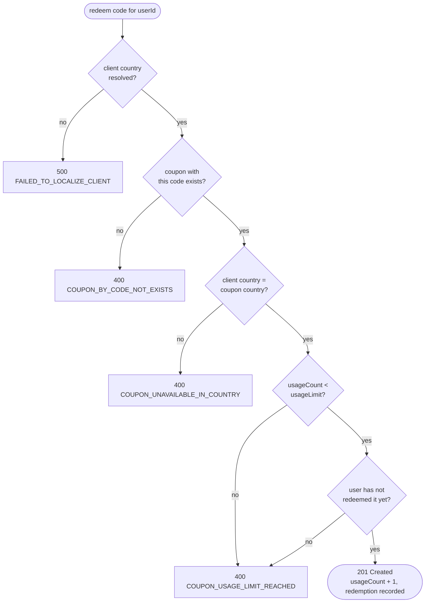

# Business Rules

## Coupons

A coupon is an entitlement that end users can redeem a limited number of times, in one country only. The service
tracks eligibility and usage - it does not know what the coupon is worth or what it is redeemed for.

- **`code`** - 1-255 alphanumeric characters, unique. Trimmed and stored uppercase, so codes are case-insensitive:
  `summer` and `SUMMER` are the same coupon.
- **`usageLimit`** - how many times the coupon can be redeemed in total, at least 1.
- **`usageCount`** - how many times it has been redeemed so far. Starts at 0, never exceeds `usageLimit`.
- **`countryCode`** - country the coupon can be redeemed in, 1-8 letters, stored uppercase. Expected to be an
  ISO 3166-1 alpha-2 code (`PL`, `DE`), as that is what the geolocation service returns - other values are accepted
  but can never match.
- **`createdAt`** - creation time, set by the service.

Coupons can be created, listed (optionally filtered by exact code) and fetched by id. They cannot be edited or
deleted, and they do not expire - a coupon stays redeemable until its usage limit is reached.

## Redemption

A redemption request names a coupon `code` and the `userId` of the user redeeming it. The user's country is not part
of the request - the service resolves it from the client's IP address:

- the first address in the `X-Forwarded-For` header, if present,
- otherwise the address of the connection.

The IP address is translated to a country code by [ip-api.com](https://ip-api.com). Results are cached, see
[Geolocation Caching](./Geolocation-Caching.md).

A redemption succeeds only if all of the following hold, checked in this order:

On success the coupon's `usageCount` grows by one and a redemption record (coupon, user, time) is stored. A rejected
redemption changes nothing - the usage count and the redemption record are written in one transaction, so a
redemption that fails a later check does not use up the coupon.

### Guarantees

- **The usage limit is never exceeded**, even when many users redeem the last uses of a coupon at the same moment.
  See [Redemption Concurrency](./Redemption-Concurrency.md).
- **A user redeems a coupon at most once**, also under concurrent requests - enforced by a database constraint.
- **Codes are unique** - creating a coupon with an existing code (in any letter case) fails with
  `409 COUPON_ALREADY_EXISTS`.

## Known limitations

These follow from the current design and are worth knowing before relying on the service:

- **`X-Forwarded-For` is trusted as sent.** A client calling the service directly can put any IP address there and
  pick its country. The country restriction holds only behind a proxy that overwrites the header.
- **`userId` is not authenticated.** The caller states who the user is; the service only ensures that the same
  `userId` cannot redeem a coupon twice.
- **A repeated redemption by the same user is reported as `COUPON_USAGE_LIMIT_REACHED`**, the same as an exhausted
  coupon - from the user's point of view, their personal limit of one is reached.
- **Geolocation outages block redemptions.** If ip-api.com fails or rate-limits the service and the address is not
  cached, redemption fails with `500 FAILED_TO_LOCALIZE_CLIENT`.
- **A missing coupon code is a `400`, not a `404`**, since the code is part of the request body rather than the URL.

## Glossary

- **Coupon** - redeemable entitlement identified by a unique code.
- **Redemption** - single successful use of a coupon by a user.
- **Usage limit** - total number of redemptions a coupon allows, across all users.
- **Usage count** - number of redemptions made so far.
- **Operator** - whoever creates coupons; the coupon API has no authentication of its own.
