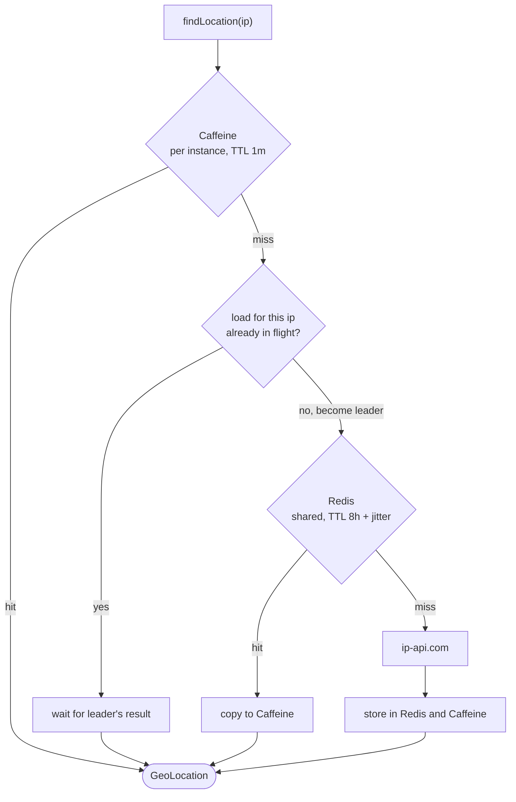
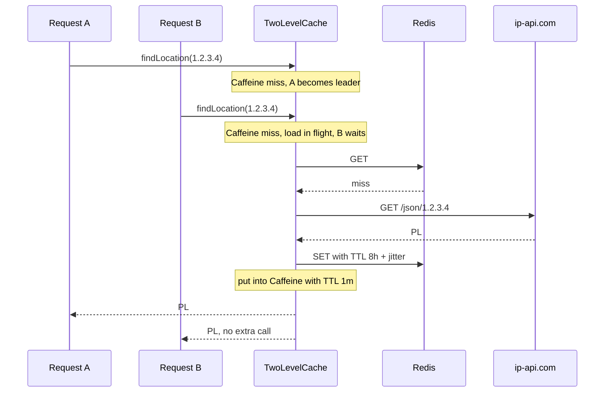

# Geolocation Caching

Every redemption needs the client's country, resolved from its IP address by [ip-api.com](https://ip-api.com). The
free tier allows 45 requests per minute, and an IP's country rarely changes, so results are cached.

## Design

`GeoLocationRestClient.findLocation` is annotated with `@Cacheable("ipAddrGeoLocation", sync = true)` and backed by
`TwoLevelCache`:

- **Local level - Caffeine**, in memory of each instance. Short TTL (1 minute), bounded size.
- **Shared level - Redis**, common to all instances. Long TTL (8 hours) plus random jitter.



## Thundering herd protection

A cache miss on a popular key can send many simultaneous requests to the external API. Three mechanisms prevent that:

1. **Single-flight loads.** The first request that misses the local cache becomes the leader for that IP; concurrent
   requests for the same IP on the same instance wait for the leader's result instead of loading themselves. The
   leader stores the value in Caffeine before it releases the in-flight slot, so late arrivals find it. With N
   instances, a key is loaded at most N times at once.
2. **TTL jitter.** Redis entries live 8 hours plus a random 0-1 hour (`JitteredTtl`), so entries written together - for
   example right after a cold start - do not all expire together.
3. **Failures are not cached.** A failed load is shared with the requests already waiting for it, then forgotten - the
   next request tries again.



## Design decisions

**Why not Spring's `sync = true` on Redis alone?** `RedisCache` has no per-key coordination. With the default
non-locking writer every concurrent caller still loads; with the locking writer the lock covers the whole cache, so
misses for all IPs, across all instances, queue behind one lock while it is held over a 1.5 second HTTP call.

**Why not a distributed per-key lock in Redis?** It would cut the per-key herd from N instances to 1, but Redis cannot
notify waiters when a value appears (they must poll), a crashed leader leaves waiters stuck until the lock expires,
and waiters cannot see the leader's error. With few instances the gain does not pay for that complexity. If the
service grows to many instances, add it behind the local single-flight, not instead of it.

**Why is the local TTL short?** Local entries are never invalidated across instances. An eviction or an update
reaches Redis and the local cache of one instance only; others keep their copy until it expires. The local TTL bounds
that staleness, and also how long a local copy can outlive the Redis entry it was copied from. Herd protection needs
only a short window, as single-flight handles concurrent misses and Redis serves everything after.

**Why are in-flight loads kept outside Caffeine?** Caffeine logs a warning with a stack trace for every stored future
that fails, which would duplicate the log of every geolocation failure.

## Limitations

- **Cold cache:** after Redis is flushed, every distinct IP misses, and single-flight cannot merge different keys. A
  rate limiter in front of ip-api.com would be needed to stay within its quota.
- **Integration tests run with caching disabled** (`spring.cache.type: none`), so the Redis level is covered by unit
  tests only (`TwoLevelCacheSpec`, `RedisCacheConfigurationSpec`, `JitteredTtlSpec`).

## Configuration

```yaml
spring:
  cache:
    type: redis                       # none disables caching entirely

sample-coupon-service:
  caching:
    ip-addr-geo-location-ttl: 8h        # base TTL in Redis
    ip-addr-geo-location-ttl-jitter: 1h # upper bound of random extra Redis TTL
    local-ttl: 1m                       # TTL in Caffeine, keep well below Redis TTL
    local-max-size: 10000               # maximum entries in Caffeine per cache
```
