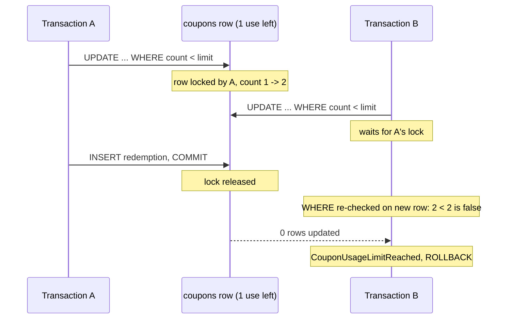

# Redemption Concurrency

When many users redeem the last uses of a coupon at the same time, the service must accept exactly as many
redemptions as there are uses left. A naive "read count, check, write count + 1" lets concurrent requests read the same
count and all succeed, overshooting the limit and losing updates.

## How it is solved

`CouponRedeemUseCase` runs in one transaction:

1. **Fetch the coupon by code** - a plain read, used for the request id and country checks.
2. **Look up the request id** - a plain read too. If a redemption with the request's `requestId` exists, the request
   is a retry of a completed one: the use case returns its request id without changing anything (or rejects the
   request, if the redemption was for another coupon or user).
3. **Reserve one use with a conditional update** (`CouponRepository.lockRedemption`):
   ```sql
   UPDATE coupons
   SET coupon_usage_count = coupon_usage_count + 1
   WHERE coupon_code = :code
     AND coupon_usage_count < coupon_usage_limit
   ```
   The check and the increment are a single statement. PostgreSQL locks the coupon row, so a concurrent transaction
   updating the same coupon waits. When the first one commits, PostgreSQL re-evaluates the `WHERE` clause against the
   new row version (`READ COMMITTED` behavior), so the waiting transaction sees the updated count. Zero rows updated
   means the limit is reached - the use case throws `CouponUsageLimitReached`.
4. **Insert the redemption record.** The unique constraints on `(coupon_id, user_id)` and on the request id reject a
   second redemption by the same user or under the same request id. The exception rolls back the whole transaction,
   including the increment from step 3, so a rejected duplicate does not use up the coupon.



If A rolls back instead of committing, B's update proceeds against the original row and succeeds.

### Retries

The request id lookup in step 2 does not wait for requests in progress - it sees only committed redemptions. A retry
sent while the original request is still running finds nothing and continues like any other request: it waits for
the original's lock in step 3 and then fails, either on the limit (the original took the last use) or on a unique
constraint in step 4 (the original redeemed the coupon for the user under the same request id). Both report
`CouponUsageLimitReached`. Sent again after the original completes, the retry finds its redemption in step 2.

Making an overlapping retry wait for the original instead - by locking the coupon row before step 2 with
`SELECT ... FOR UPDATE` - would hold the lock for every redemption, while retries usually come after a timeout, when
the original has long completed. Either way, a retry never redeems the coupon twice.

## Properties

- **No deadlocks.** Each transaction locks a single coupon row. The foreign-key check of the redemption insert takes a
  `KEY SHARE` lock on that same row, which is compatible with the lock the transaction already holds.
- **No lost updates or overshoot**, regardless of how many instances of the service run - the coordination happens in
  the database.
- **Cost:** redemptions of the same coupon are serialized while their transactions run. Redemptions of different
  coupons do not affect each other. Geolocation is resolved before the transaction starts, so the lock is held only
  for two short statements.

## Testing

`CouponRedeemConcurrentSpec` (integration test, real PostgreSQL via Testcontainers) checks the locking behavior
deterministically, without relying on timing:

1. A test transaction reserves the last use of a coupon and stays open.
2. A competing redemption starts on another thread.
3. The test waits until PostgreSQL reports that backend as waiting on a lock (`pg_stat_activity.wait_event_type =
   'Lock'`) - proof it is blocked rather than reading a stale count.
4. The test transaction then commits (competitor must fail with `CouponUsageLimitReached`) or rolls back (competitor
   must succeed).

The same setup covers a retry: the test transaction redeems the last use for a `requestId`, a retry of that request
blocks and fails after the commit, and a retry sent after the commit must succeed without taking another use.

The spec is deliberately not `@Transactional` - every redemption needs its own committed transaction to contend for
the row. Duplicate redemptions by the same user and sequential retries are covered by `CouponRedeemUseCaseSpec`.
