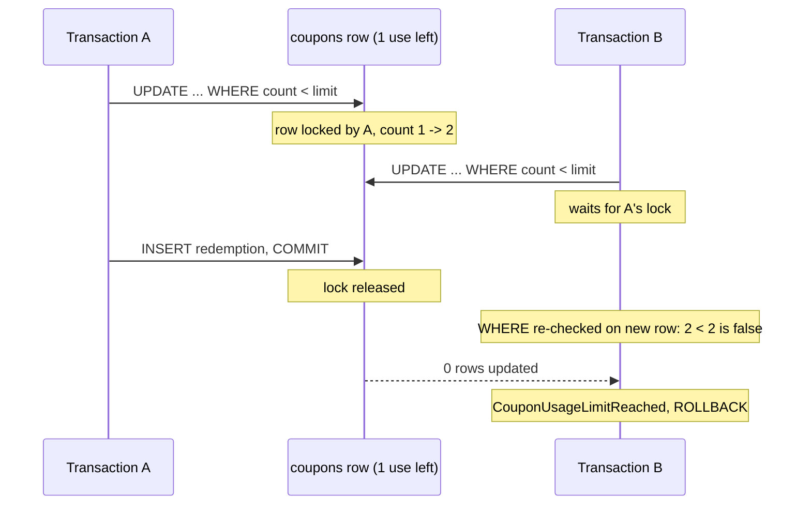

# Redemption Concurrency

When many users redeem the last uses of a coupon at the same time, the service must accept exactly as many
redemptions as there are uses left. A naive "read count, check, write count + 1" lets concurrent requests read the same
count and all succeed, overshooting the limit and losing updates.

## How it is solved

`CouponRedeemUseCase` runs in one transaction:

1. **Fetch the coupon by code** - a plain read, used only for the country check.
2. **Reserve one use with a conditional update** (`CouponRepository.lockRedemption`):
   ```sql
   UPDATE coupons
   SET coupon_usage_count = coupon_usage_count + 1
   WHERE coupon_code = :code
     AND coupon_usage_count < coupon_usage_limit
   ```
   The check and the increment are a single statement. PostgreSQL locks the coupon row, so a concurrent transaction
   updating the same coupon waits. When the first one commits, PostgreSQL re-evaluates the `WHERE` clause against the
   new row version (`READ COMMITTED` behavior), so the waiting transaction sees the updated count. Zero rows updated
   means the limit is reached - the use case throws `CouponUsageLimitReached`.
3. **Insert the redemption record.** The unique constraint on `(coupon_id, user_id)` rejects a second redemption by
   the same user. The exception rolls back the whole transaction, including the increment from step 2, so a rejected
   duplicate does not use up the coupon.



If A rolls back instead of committing, B's update proceeds against the original row and succeeds.

## Properties

- **No deadlocks.** Each transaction locks a single coupon row. The foreign-key check of the redemption insert takes a
  `KEY SHARE` lock on that same row, which is compatible with the lock the transaction already holds.
- **No lost updates or overshoot**, regardless of how many instances of the service run - the coordination happens in
  the database.
- **Cost:** redemptions of the same coupon are serialized while their transactions run. Redemptions of different
  coupons do not affect each other. Geolocation is resolved before the transaction starts, so the lock is held only
  for two short statements.

## Testing

`CouponRedeemConcurrentSpec` (integration test, real PostgreSQL via Testcontainers) checks the locking behavior
deterministically, without relying on timing:

1. A test transaction reserves the last use of a coupon and stays open.
2. A competing redemption starts on another thread.
3. The test waits until PostgreSQL reports that backend as waiting on a lock (`pg_stat_activity.wait_event_type =
   'Lock'`) - proof it is blocked rather than reading a stale count.
4. The test transaction then commits (competitor must fail with `CouponUsageLimitReached`) or rolls back (competitor
   must succeed).

The spec is deliberately not `@Transactional` - every redemption needs its own committed transaction to contend for
the row. Duplicate redemptions by the same user are covered by `CouponRedeemUseCaseSpec`.
